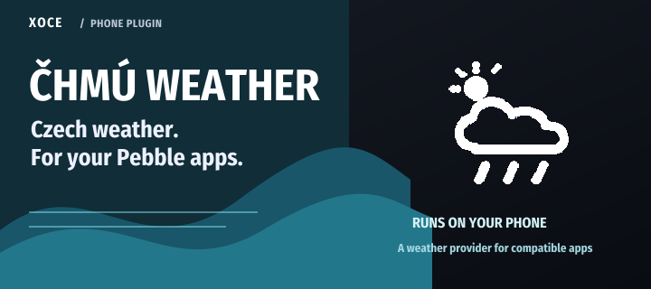

# ČHMÚ Weather for Pebble



Website artwork for the phone-only plugin; Store uploads use its icon files.
[Current artwork and provenance](store/current-artwork.json).

Unofficial weather plugin by Xef. Nearby ČHMÚ station measurements supply the
current temperature, humidity and wind when the station reports them together.
Public ALADIN supplies local forecasts. When enabled, Open-Meteo completes
missing weather fields, rain probabilities and forecasts up to seven days.
The public build excludes ČHMÚ's authenticated mobile-app service.

The plugin serves Pebble's standard `weather/location` source and runs inside
the Pebble phone app. No API key, user sign-in, separate Android app or
developer-operated server is needed.

<a id="store-update-103"></a>

## Current release · 1.0.4

**[Install from Pebble Store](https://apps.repebble.com/ef7111ffaeaf4593aaaa85ed)** ·
[Setup guide](https://xefensor.github.io/xoce/docs/pebble/chmu-weather/) ·
[GitHub release v1.0.4](https://github.com/xefensor/pebble-chmu-weather/releases/tag/v1.0.4) ·
[Support](SUPPORT.md) · [Privacy](PRIVACY.md)

Version 1.0.4 is published in Pebble Store and on GitHub. It improves settings
save/refresh feedback, station-change context and UV guidance while preserving
the public UUID and provider behaviour. The [publication record](store/publication.json)
identifies the checked public PBW; earlier releases and archives remain frozen.

## Weather readings and Activities

ČHMÚ Weather supplies weather readings for Pebble Weather and compatible apps.
Choose its readings separately from Activities. An activity is an ongoing update,
such as a Timer countdown shown on Dynamic or Halftone. This plugin supplies
weather rather than publishing Timer-style activities.

<a id="download-and-install-101"></a>

## Download and install

Use the Store link above in the official Pebble phone app. For manual installation,
download the matching public file from the **[v1.0.4 release](https://github.com/xefensor/pebble-chmu-weather/releases/tag/v1.0.4)**:

[Public PBW](https://github.com/xefensor/pebble-chmu-weather/releases/download/v1.0.4/CHMU-Weather-1.0.4.pbw) ·
[Source ZIP](https://github.com/xefensor/pebble-chmu-weather/releases/download/v1.0.4/CHMU-Weather-1.0.4-source.zip) ·
[Store package](https://github.com/xefensor/pebble-chmu-weather/releases/download/v1.0.4/CHMU-Weather-1.0.4-store-package.zip) ·
[SHA-256 checksums](https://github.com/xefensor/pebble-chmu-weather/releases/download/v1.0.4/SHA256SUMS.txt)

Open the `.pbw` with Pebble. Source and Store ZIPs are development/submission
materials, not installation files. This is the public plugin, not **ČHMÚ Weather
Personal**; there is no watch app to launch.

[Current product and settings examples](https://xefensor.github.io/xoce/projects/chmu-weather/)
identify their capture scope. The retained [English/light](docs/images/settings-en-light.png)
and [Czech/dark](docs/images/settings-cs-dark.png) repository images are historical
1.0.1 browser previews, not fresh 1.0.4 or physical-phone evidence.

## Compatibility

Use the current official Pebble phone app with plugin and Weather-provider APIs.
Enable **Settings → Plugins → Plugins / permissions preview** when offered;
labels can vary with the phone-app version. See the [official plugin guide](https://developer.repebble.com/guides/plugins/preview/).
This phone-only package needs no native watch binary or Pebble SDK. Coverage is
Czechia; see [feed contracts](docs/FEEDS.md) and the limitations below.

## Setup and use

1. Install the public plugin from [Pebble Store](https://apps.repebble.com/ef7111ffaeaf4593aaaa85ed),
   or open the matching [1.0.4 PBW](https://github.com/xefensor/pebble-chmu-weather/releases/download/v1.0.4/CHMU-Weather-1.0.4.pbw)
   with the official Pebble phone app.
2. Allow required Internet access to `data-provider.chmi.cz`. Location is optional
   for saved places and used for the current-location entry. Backup observations
   (`opendata.chmi.cz`) and Open-Meteo (`api.open-meteo.com`) have optional network
   permissions; allow Open-Meteo if you want its completion fields.
3. Set your weather places and units in Pebble. Select **Settings → Weather →
   Weather provider → ČHMÚ Weather** for the built-in Weather app and timeline.
4. Open ČHMÚ Weather in Pebble's **Plugins** tab. Under **Latest loaded readings**,
   choose **Refresh data**, then inspect the reading and its measured/forecast status.
5. Leave **Temperature station** on **Automatic nearby station**, or choose an
   eligible station for that saved place. Settings save automatically; use
   **Refresh data** to inspect the new result. Expand **Source details** for ages
   and individual-field provenance.

Plugin-aware consumers can also choose its `weather/location` readings directly.
This is separate from Activities and from choosing the built-in Weather provider.
The [illustrated setup guide](https://xefensor.github.io/xoce/docs/pebble/chmu-weather/)
explains these paths. Pebble controls delivery to native Weather, so refreshed
phone readings do not promise an immediate watch update.

Current and historical test scope is recorded in [validation](docs/VALIDATION.md)
and the [1.0.4 evidence correction](docs/QA-ERRATA.md). Published files remain under
[`releases/`](releases/); the release workflow does not submit a Store listing.
See [publishing and current status](store/PUBLISHING.md).

### Settings

The settings page follows English/Czech phone language and light/dark appearance.
**Latest loaded readings** puts current values and station selection first.
**Forecast sources** controls Open-Meteo completion and forecast UV;
**Source details** expands timestamps and provenance. **Setup and help** explains
Weather provider selection and coverage. Changes save automatically; Refresh is a
separate data request. UI text and diagnostics do not redefine a forecast as a
measurement.


### Weather sources

| Reading | Source and behavior |
| --- | --- |
| Current temperature | ČHMÚ station measurement, at most one hour old; otherwise a forecast marked `~` in direct plugin readings |
| Humidity and wind | Measurements from the temperature station at the same timestamp when available; each missing field falls back to public ALADIN, then enabled Open-Meteo |
| Conditions | Public ALADIN forecast, with enabled Open-Meteo filling missing values |
| Hourly series | 48 slots for today and tomorrow; the active slot uses a fresh station measurement, forecasts supply other slots, and retained ALADIN context can fill missing past hours |
| Daily forecast | Complete public ALADIN ranges; enabled Open-Meteo supplies full days when ALADIN is incomplete, up to seven days |
| UV | Open-Meteo cloud-aware forecast daily peak, or Off |
| Precipitation probability | Open-Meteo hourly and daily probabilities; never inferred from rainfall amounts |
| Feels-like temperature | Calculated shade estimate using the displayed temperature, relative humidity and sustained 10 m wind, when all inputs are usable |
| Sunrise and sunset | Calculated locally with SunCalc |

**Complete with Open-Meteo** is on by default. It adds rain probabilities,
missing fields and later local forecast days. Turning it off prevents all
Open-Meteo requests and use of cached Open-Meteo values.

The separate **UV source** setting has two public-build choices:

| Choice | Behavior |
| --- | --- |
| Open-Meteo — default | Cloud-aware forecast daily peak; requires Open-Meteo completion to be enabled |
| Off | Omits UV from plugin output |

UV is a forecast, not an instantaneous measurement. Settings show its source
and download time. Selecting
Open-Meteo while completion is off shows an instruction to enable completion;
it does not enable that service automatically.

The public build cannot enable ČHMÚ app daily summaries or ČHMÚ app UV, even
through old saved settings or configuration messages. Its manifest does not
request `chmu.rails.cz` access, and its script excludes installation
authentication. Old app-service cached values and diagnostics are excluded.
An old ČHMÚ UV preference becomes Open-Meteo when completion is enabled, or
Off when completion is disabled. Explicit Open-Meteo/Off choices remain.
With completion off and UV Off, public ČHMÚ observations, ALADIN and local
calculations still work. Rain probabilities and later forecast days can be absent.

Changing a source setting excludes its disabled cached values. A request
already sent can finish; obsolete updates do not replace the current readings.
Turning a source off does not retract weather already stored by Pebble or
another watchface. See [privacy information](PRIVACY.md) for network and storage
details.

For České Budějovice, automatic station selection normally chooses **Rožnov**.
Automatic mode can try up to three eligible nearby stations when the first has
no usable fresh temperature, within the request's time budget. A manually
chosen station stays fixed. Missing humidity or wind never causes a reading
from another station or timestamp to be silently attached to that temperature.
Temperature retains decimal precision and rounds only once for display in the
chosen Celsius or Fahrenheit unit. The actual observation timestamp controls
freshness: downloading the same measurement never makes it younger.

Current and future forecasts can be reused offline for up to **six hours**
from the original body download. Rechecking an unchanged response does not
reset these ages.

The plugin retains ALADIN temperature and condition forecasts for already-past
hours of today's Prague date. If a later model run drops the morning, those
previously downloaded hours can preserve context for today's range. They remain
forecasts and cannot supply current or future weather. A cold start midway
through the day cannot reconstruct hours the plugin never received.

If today's ALADIN coverage remains
incomplete and completion is enabled, the plugin uses Open-Meteo's full-day
range. With completion off, an available partial ALADIN range is labelled as
partial in settings and source metadata; Pebble's native bridge may omit that
label. Future ALADIN daily ranges require complete coverage. The national ČHMÚ
outlook is not presented as a local forecast.

Conditions use ČHMÚ's published icon meanings where available. Pebble's shared
condition vocabulary is less detailed, so fog, freezing rain and some severe
weather symbols cannot be represented exactly. Unknown symbols use a
quantitative fallback only when its inputs support it.

Direct source subscriptions request a **30-minute** refresh interval. Native
Weather uses the Pebble phone app's own schedule (about hourly in the inspected
version); the plugin cannot force that importer to run every 30 minutes.
Station HTTP results can be reused for five minutes and forecasts for
30 minutes across consumers. The settings Refresh button bypasses those short
reuse windows; failures retain usable cached data with its original timestamps.

Pebble plugins cannot use JavaScript timers. The client checks its six-second
HTTP limits and 17-second overall budget before starting work and when bridge
calls finish. A pending call cannot be interrupted by those checks; Pebble
enforces the final 20-second source-session timeout. GPS uses its native
timeout, capped at seven seconds or the remaining request budget.

When a weather service supplies an ETag or Last-Modified validator, the next
check can use a conditional GET. An HTTP 304 reuses the validated body while
preserving its original download, source and measurement times. It reduces
response payloads where supported; the inspected public graphs and Open-Meteo
did not provide validators.
Refresh timing and the six-hour forecast limit stay the same. Responses marked
`no-store` are not saved as weather bodies or retained forecast context.

Settings distinguish stale readings, network failures and places outside
coverage. They retain the last successful download time and show the station
measurement's age. A download time does not replace the measurement timestamp.

### Coverage and Pebble limitations

The bundled catalogue covers Czech temperature stations and ALADIN town
points. A forecast town and measurement station must be within 30 km.
When the model reports elevation, automatic selection requires stations within
150 m of it and tries nearby alternatives from that suitable group. The station
picker lists supported choices within 30 km with distance and elevation. A station does not measure the
exact street or microclimate where the phone is. Unsupported places are
omitted; Pebble's provider integration can fall back for that whole location.

Selecting a provider does **not** mean Pebble fills each missing optional field
from another provider. The plugin must supply the fields itself. Pebble's
current importer accepts today's scalar UV value, daily precipitation
probabilities (or the scalar probability as a fallback for today), and current
feels-like. It does not import separate hourly or daily UV series. Which
readings and alerts appear on the watch also depends on PebbleOS's UI.

PebbleOS's main Weather screen reads the active hourly slot. In each refreshed
payload, the plugin puts the same fresh station measurement into that slot and
the scalar current temperature, so the main screen, detailed report and
watchface receive a consistent current reading.
Past and future slots keep their forecast meaning. Retained context can fill
missing past slots; current and future slots require usable current forecast
data. The raw model response is unchanged.
Per-hour source metadata identifies the blended measurement. Once it expires,
the slot returns to the model forecast. The built-in weather bridge can discard
estimate markers and custom source details. The phone app controls native
Weather delivery timing. If the watch advances to a new hourly slot before the
next import, it can show that slot's forecast until another update arrives.

Direct consumers can read observation timestamps, `is_forecast`, source and
station metadata, UV provenance, calculated feels-like provenance, and daily
forecast sources. Halftone can use the selected weather readings through its global complication
choices. Direct consumers retain the plugin's source properties; the native
Weather bridge does not retain every custom property. If a station observation is usable but too little forecast data is
available, direct consumers can still receive the observation; Pebble's native
provider bridge may reject the incomplete location and use its own fallback.

## Development

Pushes and pull requests run read-only source/candidate checks. GitHub
publication is a separate manual
[release workflow](https://github.com/xefensor/pebble-chmu-weather/actions/workflows/release.yml)
on main, used only when a release has been requested. It verifies exact frozen
public packages and uploads them without rebuilding or submitting a Store
listing. Safe reruns preserve published tags and assets.

See [the release workflow](docs/GITHUB-RELEASES.md) for preparation and recovery,
[maintainer notes](AGENTS.md) for repository boundaries, and
[validation](docs/VALIDATION.md) for the scope of runtime, browser and service
checks. Published packages stay frozen; later documentation-only changes on
`main` do not rewrite published downloads, including 1.0.4.

### Build and check

```sh
npm ci --ignore-scripts
npm test
npm run build
# Optional: makes real public weather requests against these exact bytes.
python3 scripts/smoke.py --pbw build/candidate/CHMU-Weather-1.0.4.pbw
```

Use the pinned Node 22.23.4 and Python 3.12.15 in `.node-version` and
`.python-version` for reproduction (supported minimums: Node 20+, Python 3.10+).
The Pebble SDK is not required for this
phone-only PBW. The pinned esbuild release bundles JavaScript. Packaging is
deterministic and includes permission metadata and license notices.
The default public output is `build/candidate/CHMU-Weather-1.0.4.pbw` for the
current package version. Explicit `--output` paths are supported outside frozen
`dist/` and `releases/`; use the current versioned basename. See [CONTRIBUTING](CONTRIBUTING.md), [validation status](docs/VALIDATION.md) and [XOCE integration checks](docs/XOCE-INTEGRATION.md).

### Personal build

```sh
npm run build:personal
```

This creates `build/personal/CHMU-Weather-1.0.4-personal.pbw`, labelled
**ČHMÚ Weather Personal** with a separate plugin UUID. It can coexist with
the public build. After installing it, select **ČHMÚ Weather Personal** as
the weather provider or complication source to use it.

The personal build keeps ČHMÚ app local daily summaries and clear-sky noon
UV enabled by default, with their independent settings. It creates its own
random installation identifier and service credentials when needed. No
credentials are embedded in the PBW. ČHMÚ UV is a clear-sky noon forecast,
not a live or cloud-adjusted reading. App daily data must pass the six-hour
source/download age checks; UV must match today and have an original update
no more than seven days old.

This build is excluded from public release artifacts and the Store package.
Its build recipe remains in the source. Third-party access to the authenticated
app service has not been confirmed by ČHMÚ; the website/open-data CC BY licence
is not treated as permission for that separate service.

To regenerate the static catalogue, install development-only `pyproj` and run
`python3 scripts/update-catalog.py`. See [feed details](docs/FEEDS.md).

## Licence

Weather data: **Český hydrometeorologický ústav (ČHMÚ)** and, when enabled,
**Open-Meteo**. Public ČHMÚ graph/open-data sources, the derived catalogue and
Open-Meteo forecasts use CC BY 4.0 attribution. ČHMÚ's
[website terms](https://www.chmi.cz/vylou%C4%8Den%C3%AD-odpov%C4%9Bdnosti), inspected
on 31 October 2026, licensed its published website products under CC BY 4.0. Personal-build app
data is attributed separately to ČHMÚ. Feels-like is a plugin-calculated estimate.
This project is independent of ČHMÚ, Open-Meteo and Core Devices.
See [privacy information](PRIVACY.md) and [third-party notices](THIRD_PARTY.md).

Project code uses [PolyForm Noncommercial 1.0.0](LICENSE), with attribution.
Weather data and third-party libraries retain their own licenses.

Required Notice: ČHMÚ Weather for Pebble by Xef (https://github.com/xefensor/pebble-chmu-weather)
